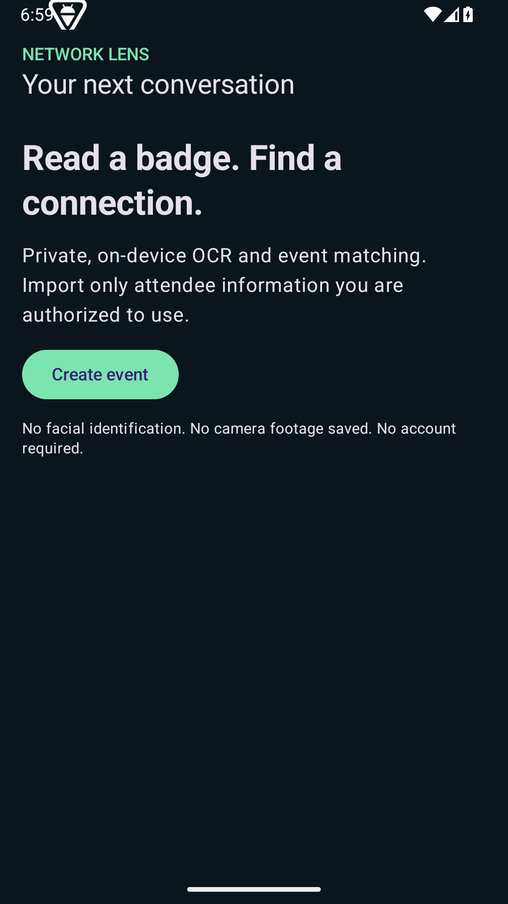
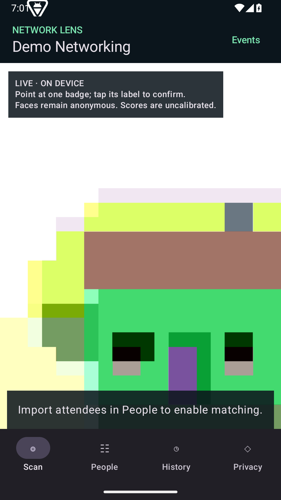

# Network Lens

An Android networking companion that reads **visible badges**, matches text to an authorized event directory, and remembers manually confirmed encounters. Local-first, no backend, no paid API, no face identification.

Public source: https://github.com/drafteruper/network-lens-android . Version 0.1.0 debug has been built and installed on an Android 15 emulator: **20 unit tests and 5 device tests passed**, lint has no errors. See [the validation report](docs/VALIDATION.md) for limits. No physical Galaxy Z Flip 6 test has been performed.

 

## What this MVP does

- Saves events with a name and optional HTTPS reference URL.
- Imports UTF-8 CSV attendee lists, validates fields, skips exact duplicate records; supports manual entry and search.
- Displays a rear-camera preview with bundled on-device Latin-script OCR and anonymous face outlines.
- Places name/company candidate labels on **badge text regions**, not faces. Tap a label to inspect evidence and confirm.
- Colors strong badge matches green for imported `investor` categories, yellow for `startup`, grey otherwise. Categories are supplied data, not AI judgments or independently verified facts.
- Keeps an event-scoped history of confirmed attendee IDs, last-seen time, text-match evidence, and networking status. Re-scan and confirm to update last-seen.
- Provides interested/met/follow-up/not-relevant markers, company/role/name search, and category/status filters.
- Provides individual history deletion, event deletion, all-data deletion, saving toggle, and 7/30/90-day encounter retention.

## Important limits

This is a badge-first prototype, not reliable identification of everyone in a room. It does **not** search faces, generate/store embeddings, associate a badge with a nearby face, or recognize people after their badge disappears. Face outlines are anonymous and ephemeral. It does not record camera footage or microphone audio.

Only full names with at least two normalized words become automatic candidates. Name alone = **70% estimated match score**; name and company within the same OCR text block = **95% estimated match score**. These are documented heuristic evidence weights, **not statistically calibrated identity probabilities**. Duplicate top candidates or multiple names within a block remain ambiguous. OCR can split a name and company into separate blocks, so a valid badge may remain at 70%. Partially obscured or misspelled names require manual search; this is intentional. No face-detection score is used for identity.

Event URLs are reference-only. Luma requires organizer API access for guest-list integration; importing an authorized CSV is supported instead. No automated public-profile lookup, web scraping, reverse-image search, or glasses hardware integration is included. No API credentials are required. Profile links open in your external browser only when tapped.

Unmatched text is shown transiently but not stored as an “unknown person”: without a confirmed attendee ID, the app cannot truthfully count unique unknown people. Dashboard counts are saved attendee profiles, not crowd counts. Imported roles/categories are not verified externally.

## Install on Galaxy Z Flip 6

Use the **unfolded inner screen**. Minimum Android 8 (API 26); compile/target API 35. Samsung shipped the Z Flip 6 with Android 14, which is within this app's supported range. The actual OS installed on your phone has not been inspected. Cover-screen operation is not implemented.

1. Download the `network-lens-0.1.0-debug.apk` release asset when a release is available.
2. Open it on the phone. If prompted, allow **Install unknown apps** for the browser or Files app you used. Samsung Auto Blocker may also prevent sideloading; consult your device's settings if installation is blocked.
3. Install Network Lens. You can revoke the install-source permission afterward.
4. Create an event, then import an authorized CSV or add attendees.
5. Open **Scan**, grant camera permission, point at a clear badge, tap its label, inspect the candidate, and select **Confirm & save**.
6. Use **History** to review encounters and follow-ups. Use **Privacy** for deletion and retention.

The debug APK is signed with a development key, not a production release identity. Later builds may use a different debug certificate; Android will require uninstalling the old app in that case, which erases its local data. Do not treat this build as a production deployment.

## CSV format

```csv
name,company,role,category,link
Alex Example,Example Ventures,Partner,investor,https://example.org
Sam Sample,Demo Labs,Founder,startup,https://example.org
```

Only `name` is required. Categories: `investor`, `startup`, `other` (default). Optional links must use HTTPS. Maximum 2 MB / 5,000 imported rows per file. Quotes, escaped quotes, commas inside quoted fields, BOM, CRLF and multiline fields are supported. A malformed file is rejected before database insertion. `examples/attendees.csv` contains **fictional test data only**. There is no automatic guessing of company type from a job title.

## Build

Install Android Studio, JDK 17, Android SDK Platform 35 and Build Tools 35.0.0. Open this folder as a project and allow Gradle sync. Use the checked-in Gradle wrapper; do not use Java 25 with this build. Android Studio can write `local.properties` with your local SDK path; that file is intentionally ignored.

Windows PowerShell:

```powershell
.\gradlew.bat testDebugUnitTest lintDebug assembleDebug assembleDebugAndroidTest
```

macOS/Linux:

```sh
chmod +x gradlew
./gradlew testDebugUnitTest lintDebug assembleDebug assembleDebugAndroidTest
```

APK: `app/build/outputs/apk/debug/app-debug.apk`. First build needs internet for Maven artifacts; the bundled OCR/face models are available offline after installation. Run instrumentation tests on an emulator or USB-debugging device with `./gradlew connectedDebugAndroidTest`. JVM tests cover text matching and CSV validation. Instrumentation tests cover Room event isolation, repeated encounters, status preservation, retention and cascading deletion.

See [validation](docs/VALIDATION.md) for actual test status and [architecture](docs/ARCHITECTURE.md) for implementation boundaries. CI builds the APK, unit tests, lint and instrumentation APK. It does not run device tests unless explicitly configured to do so.

## Data and services

Only camera permission is requested by the application. CSV import uses Android's document picker rather than broad storage access. No backend, API keys, application analytics or network permission is configured. Google ML Kit dependencies may contribute manifest entries; see the checked APK permission report in validation. No input images or facial data are persisted or sent to a server by application code. Browser links leave the app when you explicitly open them.

Attendees and encounters live in Room within Android's private app storage. System backups/device-transfer backups are excluded. There is no extra application-level encryption, so use a device screen lock. Retention removes encounter records on startup/event selection or retention changes; event directories remain until deleted. Disabling persistence does not delete old history. Manual status markers also create saved encounter records while persistence is enabled.

Read [services and research](docs/SERVICES.md) for source links, licensing and omitted integrations. The source is Apache-2.0. Google ML Kit SDKs/models are distributed under their own terms; this is **not an entirely open-source ML stack**. No personal attendee information, signing keys, credentials, or camera captures belong in the repository.

## Contribute and release

See [CONTRIBUTING.md](CONTRIBUTING.md) and [SECURITY.md](SECURITY.md). Use fictional fixtures only. Run unit tests, lint and the build before submitting changes. Never attach attendee data to public bug reports.

The GitHub Actions workflow uploads a debug APK artifact. A maintainer may create a tagged prerelease and attach the validated debug APK plus a SHA-256 checksum. Production distribution needs a separately established signing key and secure signing workflow; neither is supplied here. `assembleRelease` alone does not produce a production-signed package. See [release instructions](docs/RELEASING.md).
